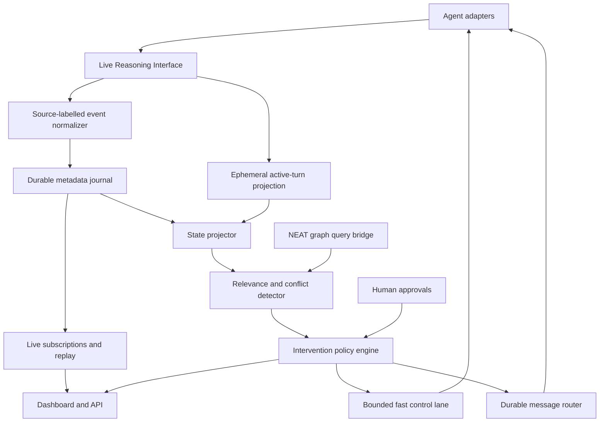

# 03 — Greenfield system architecture

## Architectural idea

Build a control plane from first principles with three loops. The flagship loop must complete **inside the target's ongoing task** on at least one verified runtime:

1. **Observation:** capture authorised live deltas through the Live Reasoning Interface (LRI), normalise source-labelled events, and journal durable metadata.
2. **Understanding:** project agent state, join it with NEAT dependency evidence, detect affected work.
3. **Action:** authorise and dispatch an instruction through a fast control lane at the best supported boundary; verify incorporation and the changed effect separately.

## Core components to implement

### 1. Session Registry

Tracks `agent_id`, `session_id`, `provider`, workspace, repository, worktree, turn, owner, lease heartbeat, actual permissions and runtime capability probes. Sessions are leased; stale ones become `offline` rather than silently remaining `active`.

### 2. Agent Adapters

Connect to authorised agent processes/sessions through supported APIs, subscribe to lifecycle/output events, normalize tools and token usage, and issue steer/interrupt operations. Every adapter implements `discoverCapabilities()` and returns truthful, runtime-derived capabilities.

### 2a. Live Reasoning Interface (LRI)

Subscribe to authorised runtime deltas as soon as emitted. Preserve provider/session/turn/item IDs, source event ID, order, source and arrival times, and any reported usage. Keep `reasoning_trace_delta`, `reasoning_summary_delta`, `assistant_output_delta`, `tool_intent`, `tool_start`, `tool_result`, `usage_update`, and `stream_gap` distinct. An ephemeral, redacted active-turn projection serves permitted observers and intervention policy; missing content, delayed updates and real silence carry different quality labels. An opt-in intent digest is marked `inferred`, never observed thought.

LRI uses bounded per-session buffers, resubscription cursors where the provider permits them, dropped-event counters and explicit gap events. Bulky text cannot block the control lane. Full content capture is opt-in, permission-scoped and time-bounded; the default durable journal holds metadata and aggregates, not every text delta.

### 3. Event Collector and Journal

Validate and redact incoming events, assign immutable event ID, monotonic per-session sequence, server receive time, and append permitted durable metadata to storage. Acknowledgement only after transaction commit. Reconnection resumes at a stored cursor or records a gap if the source cannot replay. LRI deltas use this same `EventEnvelope` identity; there is no second event bus or competing ID scheme.

### 4. Transport and Routing

Addressed send (`to_agent`, `to_session`), topic subscriptions (workspace/task/file), priority, TTL, route decision, deduplication, expiration, dead-letter state and delivery attempt logs. Do not mix best-effort ephemeral presence with durable commands. The **fast steering path** is a separate bounded, high-priority processing lane for an already authorised active-turn control request; it cannot bypass journaled decisions, authority checks or send-time scope validation.

### 5. State Mirror

A materialized projection: agent/task/turn, active tool, touched files, observable actions, reported summaries, token usage, workspace snapshot, and last acknowledgment. Every field includes an evidence source and freshness timestamp.

### 6. NEAT Bridge

Resolving touched or intended files into graph nodes; retrieving impacted dependents and applicable policies; returning versioned, evidence-backed findings. Strict separation of NEAT graph claims and agent intent inference.

### 7. Intervention Controller

Ranks evidence-based conflicts; validates causal preconditions, authorisation, urgency and probed **active-session** capabilities; chooses `steer_now`, `interrupt_then_continue`, `checkpoint_before_tool`, `queue_next_turn` or `observe_only`; records outcomes and inhibits repeat storms. A checkpoint is available only to Signal-managed sessions with a verified safe pre-tool hook and explicit permission.

### 8. API and Dashboard

Human-visible controls, independent audit view, replay, agent graph, conflict queue and precise delivery state. Default read-only/Observe mode.

## V0 physical deployment

Single local Node.js/TypeScript daemon added alongside NEAT. SQLite in WAL mode for journal, message state, cursors and audit; local stream fan-out over SSE. No external broker or cloud account for first prototype. Provider subprocesses connect via stdio/JSON-RPC or supported SDK APIs; an embedded HTTP server exposes localhost endpoints authenticated with per-instance tokens. The local daemon talks to NEAT core through a typed HTTP adapter.

Why this choice: reduces integration surface, keeps reproduction straightforward, and makes a working test possible before scaling. SQLite is NOT a global multi-node queue.

## Scale-out later, only if measurements justify

Swap journal abstraction to PostgreSQL and fan-out transport to a durable broker, partitioned by workspace/session. Maintain the same envelopes, idempotency keys and delivery states. Multi-tenant cloud authentication and remote agent fleet management are a subsequent milestone, not hidden V0 dependencies.

## Delivery semantics

- **Events:** at-least-once, ordered per `(session_id, stream_epoch)` by authoritative sequence; possible duplication across reconnects. Consumers deduplicate on event ID.
- **Messages:** durable before `stored` status; retry until acknowledged, expired, rejected or capped; idempotent by client key.
- **Steering:** `runtime_accepted` means only the runtime accepted the request. It does NOT imply model read, believed, or acted on it.
- **Incorporated:** `incorporated_by_agent` requires evidence the correction entered the active task; a runtime receipt or an agent saying “OK” alone is insufficient.
- **Effect:** `effect_verified` additionally requires independent tool, code, test or explicit runtime-state evidence that the next action changed. If evidence is missing, report `outcome_unknown`.
- **Presence:** best-effort heartbeat with timeout; never use presence as a safety-critical assertion.

## Failure and recovery

On restart, rebuild projections from journal/checkpoint. All operations have bounded retries/backoff; expired messages are never replayed as valid. Runtime disconnected mid-steer leaves `outcome_unknown`, not `delivered`. Interrupted turns may leave background tools active: clean-up is explicit and adapter-specific.

LRI restarts with a new `stream_epoch` when continuity cannot be proven, signals gaps to subscribers, and discards expired ephemeral text. A control request already dispatched is reconciled by native receipt ID and idempotency key; it is not blindly resent after a crash.

## No global ordering illusion

There is no guaranteed total order across distinct machines and providers. Maintain a causal DAG with `parent_event_ids`, `observed_revision`, and per-session sequence. Use server timestamps for UI ordering only, not as the sole basis for correctness.

## Design constraints

- No hidden assumptions about vendor APIs.
- No irreversible operations from inference alone.
- No ingestion of full prompts/outputs by default.
- No guaranteed millisecond latency or provider-hidden reasoning access; measure source-to-observer lag and time to verified effect on actual sessions.
- NEAT remains independently usable.
